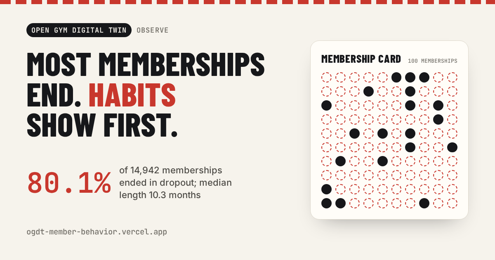

# OGDT Member Behavior: how members use the gym before they stop

**How long do memberships last, how do frequency, renewals, classes and recency line up with that, and does past weekly attendance predict the next weeks?**

**Live site:** https://ogdt-member-behavior.vercel.app · **Kaggle notebook:** https://www.kaggle.com/code/vctorandrsgmezlpez/ogdt-member-behavior-membership-and-weekly-visits

This lab is the *Observe* module of **Open Gym Digital Twin** (Observe, Connect, Predict, Simulate, Decide). It describes member behavior. Dropout prediction lives in the separate Retention lab, which uses the same Lisbon source and the same totals.



## Data (open licences only)

| Source | What it holds | Licence |
|---|---|---|
| Pinheiro, P. & Cavique, L. (2020). *Sport Services Dataset*, Mendeley Data v1, [doi:10.17632/yprk4jdgnv.1](https://doi.org/10.17632/yprk4jdgnv.1) ("Lisbon") | 14,942 users of one sports facility who enrolled between June 2014 and October 2019; one row per user, 47 columns | [CC BY 4.0](https://creativecommons.org/licenses/by/4.0/) |
| Carrera, M., Royer, H., Stehr, M., Sydnor, J. & Taubinsky, D. *Who Chooses Commitment? Evidence and Welfare Implications*, Review of Economic Studies, [doi:10.1093/restud/rdab056](https://doi.org/10.1093/restud/rdab056). Replication package: [Zenodo 5173081](https://doi.org/10.5281/zenodo.5173081) | 1,292 members of a US gym: weekly visits for the 8 weeks before a field study, then 4-week totals during and after it | Data dedicated to [CC0 1.0](https://creativecommons.org/publicdomain/zero/1.0/) in the package `LICENSE.txt` (code BSD-3-Clause). The Zenodo record lists CC BY 4.0, so the work is attributed in full either way. |

Changes made: columns were selected (no user ID, age or gender), and the analysis tables are aggregates. `data/processed/` holds the two filtered input files used by the code and the Kaggle notebook.

## Findings

Lisbon, 14,942 memberships; 11,968 dropouts (80.1%); 2,974 still active on 31 October 2019 and treated as censored.

- **Half of memberships are over by month ten.** Kaplan-Meier median 10.3 months. Still active: 84.1% at 3 months, 67.4% at 6, 41.1% at 12 (95% CI 40.2 to 41.9), 24.7% at 24, 16.3% at 36.
- **Renewals track length, by construction.** No renewal: median 3.5 months; three or more renewals: 45.1 months. You can only renew if you stay long enough.
- **Coming more often did not mean staying longer.** Raw dropout share falls from 84.7% (under 0.5 visits a week) to 65.1% (2 or more), but 12-month survival is 41.8%, 42.4%, 37.5% and 40.7% across the four bands. Frequent users enrolled later (median September 2017 vs April 2016) and were more often still active (34.9% vs 15.3%).
- **Class-goers stayed about twice as long.** 4,510 users with at least one class: median 17.8 months, 60.5% active at 12 months. 10,432 without: 8.1 months, 32.7%. Association only.
- **Before the dropout, the visits had already stopped.** Days without a visit at the end of the record: median 47 for dropouts, 5 for active users; more than 30 days for 71.4% of dropouts vs 19.0% of active users.

Carrera et al., 1,292 members, pre-study weeks with no intervention (9,044 adjacent week pairs); 95% intervals from 1,000 person-level bootstrap resamples, seed 20261110.

- **Last week is the best guide to next week.** Correlation of weekly visit counts 0.66 (0.64 to 0.68). Visited at least once: 81.6% visited the next week (80.4 to 82.6); did not: 31.9% (30.0 to 33.9).
- **A month of visits predicts the next month.** Weeks 5 to 8 before the study vs weeks 1 to 4: r 0.69 (0.65 to 0.72); AUC 0.84 (0.81 to 0.87) for any visit in weeks 1 to 4. Control group (n = 427, no incentive): pre-study 4 weeks vs the 4 study weeks r 0.80 (0.75 to 0.83), vs the 4 weeks after r 0.70 (0.63 to 0.76).

## What was dropped

An earlier version analysed monthly contract states and month-to-month attendance transitions from an archive without an open licence. That analysis and every file derived from it have been removed. No openly licensed dataset records gym contracts month by month, so there is no honest open replacement. An earlier synthetic sandbox was removed as well: this lab now uses real open data only.

## Scope and limits

- In Lisbon, average frequency, renewals, classes and days without a visit are measured over or at the end of each membership. They describe how memberships ended; they are not early signals and must not be used as predictors of the same dropout.
- Associations, not causes. Class attendance and renewals are confounded with membership length.
- One facility and one gym study. Neither represents every gym.
- In Carrera et al., visits during the study are affected by the incentives, so only pre-study weeks and the control group are used for persistence.

## Reproduce

Python 3.12 or later.

```bash
python -m pip install -r requirements.txt
python scripts/acquire.py       # Mendeley and Zenodo downloads, hashes checked
python scripts/prepare.py       # data/processed/*.csv and Kaggle dataset copies
python scripts/build_site.py    # reports/results.json, site/data/*.csv, site/assets/data.js
python scripts/build_notebook.py
python -m unittest discover -s tests
```

## Repository

```text
src/analysis.py         Kaplan-Meier, survival by group, recency, weekly persistence, bootstrap
scripts/                Acquire, prepare, build site data, build and run the notebook, social card
data/processed/         The two filtered input files (CC BY 4.0 and CC0)
reports/results.json    Every number on the site
notebooks/              Analysis notebook (executed)
publication/kaggle/     Kaggle notebook, kernel metadata and dataset metadata
site/                   Public bilingual site (static) and aggregate CSV downloads
docs/                   Methodology and data notes
```

## Licence and credit

Original code and documentation: MIT. Data keeps its own licence (above). Aggregate tables in `site/data/` are shared under CC BY 4.0 with attribution to both sources. Analysis, code and site: [Víctor Gómez](https://victor-gomez-portfolio.vercel.app).
