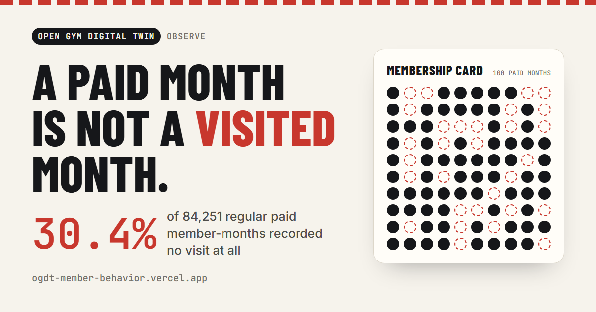

# OGDT Member Behavior: a paid month is not a visited month

**What can attendance alone tell us about gym member engagement, before anyone talks about churn?**

**Live site:** https://ogdt-member-behavior.vercel.app · **Kaggle notebook:** https://www.kaggle.com/code/vctorandrsgmezlpez/ogdt-member-behavior-monthly-gym-attendance

This lab is the *Observe* module of **Open Gym Digital Twin** (Observe → Connect → Predict → Simulate → Decide). It turns a real, historical membership archive into reproducible monthly behavior metrics with a data contract, and is explicit about what those metrics cannot support.



## Findings

Source: the author replication archive of DellaVigna & Malmendier (2006), *Paying Not to Go to the Gym*, three US health clubs, 1997–2001. Analysed subset: **84,251 regular contract member-months from 8,073 members**, with **397,354 recorded visits**.

- **3 in 10 paid months had no visit.** 30.4% of regular member-months recorded zero visits. Median 3 visits per month, mean 4.7.
- **1 in 6 three-month windows was entirely empty.** 16.1% of 64,347 complete three-month windows had no month with a visit.
- **The first month is the busiest.** The zero-visit share rises from 23.4% in the first eligible month of a run to 35.8% by month 11. This is a population view: the people who remain change over time.
- **Month to month, more go down than up.** Of 73,352 adjacent-month pairs, 39.8% fell, 28.5% stayed equal and 31.7% rose.

## Scope and limits

Monthly counts only: no days since the last visit, time of day or weekday habits. No churn model, engagement states, segments or risk scores are produced here. Prediction lives in the separate Retention lab, so behavior features cannot leak into an outcome label. The selection policy `berkeley_regular_month_v1` is conservative and documented. It does **not** reproduce the published 7,752-member sample. Excluded months become unknown, never zero. These are 1997–2001 records, not evidence about present-day gyms.

**Data rights.** The archive's redistribution terms are not established ([review](docs/publication_review.md)). This repository, the site and the Kaggle notebook therefore publish **aggregates only**: no raw tables, member IDs, member-level rows or individual trajectories. The site rejects any group below 50 member-months; its aggregate tables can be downloaded as CSV from the site (`site/data/`). Raw data and person-level derivatives stay local and are ignored by Git. The MIT license covers original code and documentation only.

## Reproduce

Python 3.14; exact versions in `requirements.txt` and `reports/berkeley/environment.json`.

```powershell
python -m venv .venv
.venv\Scripts\Activate.ps1
python -m pip install -r requirements.txt
python scripts/acquire_berkeley.py --download   # author archive, SHA-256 checked before use
python scripts/analyze_berkeley.py
python scripts/execute_notebooks.py --notebook 07_berkeley_monthly_eda.ipynb
python scripts/verify_berkeley.py
python -m unittest discover -s tests
python scripts/build_site.py                    # site data + aggregate CSV downloads
python scripts/render_og.py                     # social card from site/og.html
```

Without `--download`, acquisition copies the byte-identical archive already held by the sibling Retention lab. The comparison with that lab's feature export is checked only when the export is available.

## Repository

```text
src/data/            Source loading, hash checks, selection policy
src/features/        Monthly behavior metrics (as-of, no future information)
scripts/             Acquire, analyze, verify, notebooks, Kaggle package, site data
tests/               Temporal, coverage and monthly-metric regression tests
notebooks/07_*       Berkeley monthly analysis (aggregate figures only)
reports/berkeley/    Report, source audit, verification, integration and Kaggle evidence
handoff/             Monthly data contract, feature catalog, definitions, limits
site/                Public bilingual site (static, aggregate data only)
publication/kaggle/  Standalone notebook package
docs/                Methodology, dictionaries, data readiness, publication review, lab notes
```

**Synthetic sandbox.** Notebooks 01–03b and `reports/milestone_1.*` use the Mindweave synthetic sample (CC BY-NC 4.0). They are kept as software and methodology evidence and are never mixed with the real Berkeley population. Notebooks 04–06 are code-free roadmaps for states, segmentation and behavioral risk: the decision each would serve, the evidence it needs and the gate before any implementation. See the full [lab notes](docs/lab_notes.md), the [monthly methodology](docs/monthly_methodology.md) and the [Berkeley report](reports/berkeley/report.md).

## Source and credit

DellaVigna, S. & Malmendier, U. (2006). Paying Not to Go to the Gym. *American Economic Review*, 96(3), 694–719. Data: [author page](https://eml.berkeley.edu/~sdellavi/data/gymdata.shtml). Analysis, code and site: [Víctor Gómez](https://victor-gomez-portfolio.vercel.app).
