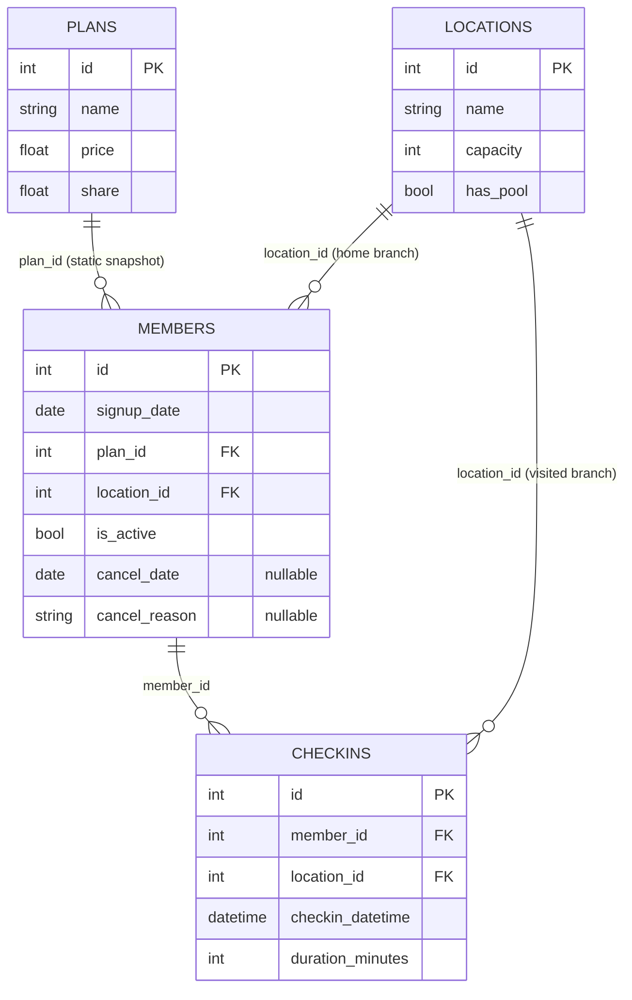

# Dataset architecture and entity relationships

Synthetic public sample at the revision in `data/raw/manifest.json`. All four public tables are loaded. The audit establishes uniqueness and non-nullness of every `id` and validates all four foreign-key relationships for this revision. Cardinality is structural; source sampling still limits observational completeness.

Contact fields are present in members and listed in the dictionary; they are unnecessary for behavioral analysis and omitted from the diagram and derived member objects.

| Table | Grain | Public rows | Key | Foreign keys |
| --- | --- | --- | --- | --- |
| members | One exported member snapshot | 300 | id | plan_id → plans.id; location_id → locations.id |
| checkins | One reported attendance event | 2,000 | id | member_id → members.id; location_id → locations.id |
| locations | One branch | 3 | id | None |
| plans | One plan descriptor | 5 | id | None |

Check-ins join to members, plans and visited branches with `many_to_one` validation. Home branch and visited branch retain different column names. Joins must preserve 2,000 events. The 300-member roster remains the output spine, so unobserved members are visible instead of silently discarded. Feature output excludes name/email/phone and contractual fields.

The event export covers IDs 1–32; the roster includes IDs 1–300. This is not a balanced longitudinal cohort. Static plan and home-branch assignments have no effective-date history. `is_active` has no snapshot timestamp. Cancellation is stored on the member row, not in an event ledger; cancellation-day ordering is unknown. No renewal, expiration, class-booking or anomaly table is public. A future Retention Lab can consume separate effective-dated contractual events keyed by a compatible member identity.
