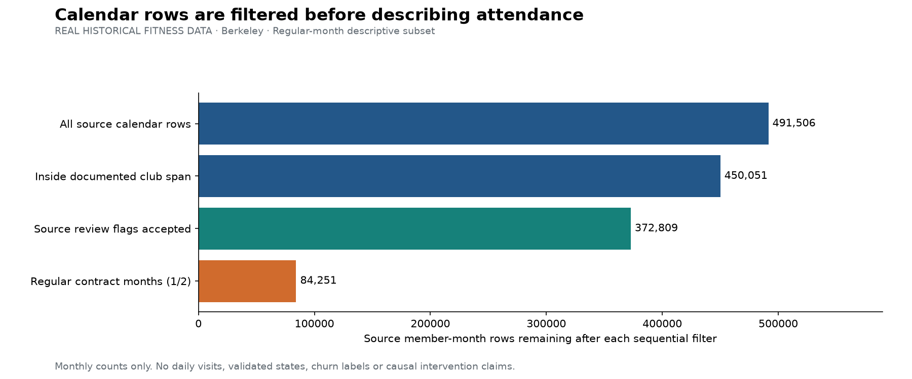
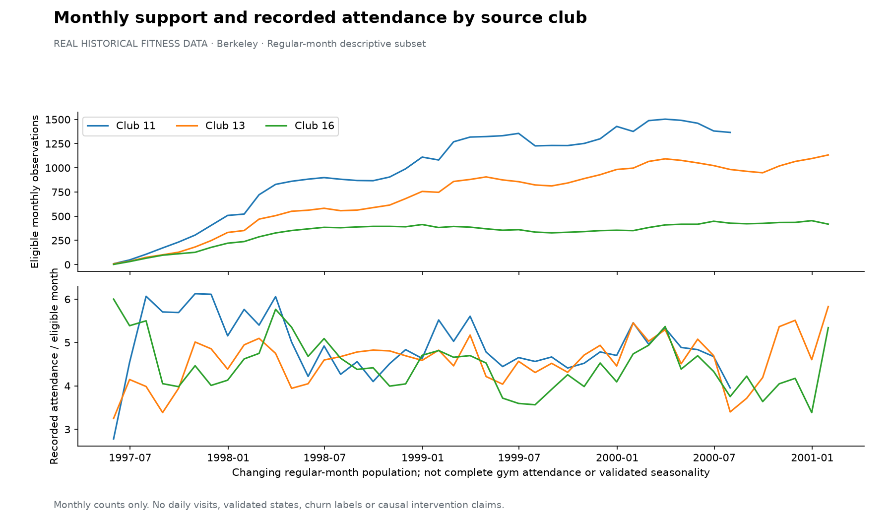
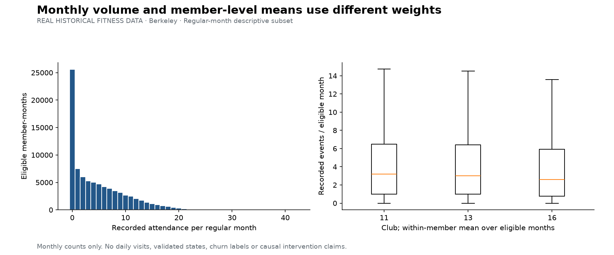
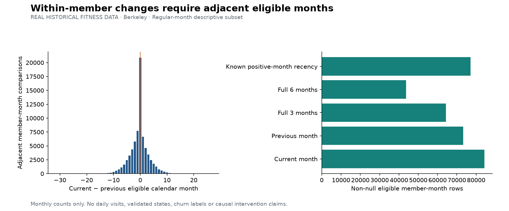

# Comportamiento mensual real — Berkeley

**Gym Member Behavior & Engagement Intelligence · revisión de fuente 19 de octubre; integración actualizada 20 de octubre de 2026**

Investigación activa de asistencia mensual con datos históricos reales de gimnasio. El sandbox sintético Mindweave permanece separado. Se revisó la adecuación antes de implementar: [plan](../../docs/project_plan.md), [evaluación](../../docs/data_readiness.md), [diccionario](../../docs/monthly_data_dictionary.md) y [definiciones](../../docs/monthly_methodology.md).

## Qué permite responder la fuente

Podemos describir volumen, cambios y consistencia mensual para la misma población que usa Retention. No contiene visitas individuales públicas en esta tabla: no permite días desde la última visita, horarios, días de semana ni ventanas exactas de 7/30/90 días. La procedencia es el [archivo del autor](https://eml.berkeley.edu/~sdellavi/data/gymdata.shtml); los nombres y flags se verificaron en el Stata, README y código del ZIP. Las fechas mensuales y las métricas son de 1997–2001, no de un gimnasio actual.

## Población y selección antes de analizar

Origen: **491,506 filas**, **10,241 IDs** y **21 variables**. Clave `(id,time)` única. Subconjunto principal: **84,251 meses regulares de 8,073 miembros**, bajo política `berkeley_regular_month_v1`. Estos conteos no reproducen la muestra publicada de 7.752 miembros ni sus exclusiones completas.

| stage | rows | members |
| --- | --- | --- |
| All source calendar rows | 491506 | 10241 |
| Inside documented club span | 450051 | 10241 |
| Source review flags accepted | 372809 | 8606 |
| Regular contract months (1/2) | 84251 | 8073 |

La cascada aplica filtros secuenciales; los flags individuales pueden solaparse. Exige contratos regulares 1/2, flags aceptados y periodo documentado. Los meses sin contrato, prorrateados, congelados, promocionales, ambiguos y fuera de seguimiento se excluyen del análisis principal. La tabla de elegibilidad conserva todas las claves originales y convierte su asistencia analítica a nulo. **No se imputan ceros a meses excluidos.**

El club 1 tiene asistencias en agosto de 2000, pero todas sus filas de ese mes tienen overtime=1 y quedan fuera. El periodo principal termina en julio de 2000 para ese club y en febrero de 2001 para los otros dos. No se decide cobertura mirando únicamente la existencia de filas o de conteos positivos.

Después de combinar todos los filtros, las filas elegibles efectivas van de **1997-05-31** a **2001-01-31**. Los límites publicados no garantizan que cada mes de frontera aporte filas elegibles bajo esta política.

## Asistencia registrada en meses elegibles

Se contabilizan **397,354 asistencias** dentro de los meses seleccionados, media **4.72**, mediana **3.0** y **30.4% de meses con cero registrado**. El denominador es meses-persona elegibles, no todos los socios o toda la asistencia del gimnasio. Estos ceros se preservan; no son etiquetas Dormant o churn. La composición regular varía por club/mes y la gráfica no valida estacionalidad ni efectos causales.

## Trayectorias y ventanas mensuales

Hay **73,352 comparaciones de meses adyacentes elegibles**, **64,347 ventanas completas de tres meses** y **43,690 de seis meses**. Los huecos o exclusiones interrumpen cada racha; no se comparan meses separados como si fueran consecutivos.

Entre las comparaciones válidas: **23,259 diferencias positivas**, **20,933 iguales** y **29,160 negativas**. Son signos aritméticos, no estados validados. El porcentaje de cambio es nulo con denominador previo cero. La longitud de racha no se denomina antigüedad contractual, y la distancia al último mes positivo no se convierte en recencia diaria.

| metric | non_null_rows |
| --- | --- |
| recorded_attendance_month | 84251 |
| attendance_previous_month | 73352 |
| attendance_change_vs_previous_month | 73352 |
| attendance_pct_change_vs_previous_month | 52865 |
| attendance_sum_3_calendar_months | 64347 |
| attendance_mean_3_calendar_months | 64347 |
| attendance_std_3_calendar_months | 64347 |
| positive_attendance_months_3 | 64347 |
| attendance_sum_6_calendar_months | 43690 |
| attendance_mean_6_calendar_months | 43690 |
| consecutive_eligible_months | 84251 |
| months_since_recorded_positive_month | 77089 |

Las seis trayectorias de volumen A–F conservan nulos/cortes en meses excluidos; no representan segmentos ni una muestra probabilística. La agregación mensual no permite reconstruir hábitos por día/hora. Una desviación estándar cero en meses con cero asistencia tampoco acredita hábito estable.

## Compatibilidad con Retention

El ZIP congelado coincide byte a byte con el origen local de Retention: `f2abbaa0312b697c56892621782073a8dd4b0fbf7cdbb8b9746a28c6398772f9`. Tabla Stata: `e56ffe6177eb5e1508555d07a756a58f9e74d051eed12601ab5a34919949289c`. Las **84,251 claves** de métricas encuentran correspondencia en la población original compartida, usando `(dataset_id, member_id, period_end)` con `dataset_id=berkeley_gym_aer_2006`.

La inspección final se actualiza con el estado vigente de Retention. Export canónico disponible: **True**. Filas canónicas cotejadas: **81,927**; filas exclusivas de Member Behavior: **2,324**. Cuando existe el export, se verifican igualdad del conteo actual y equivalencia de frontera mensual. Las diferencias de población se explican mediante familia observada hasta ese mes, excluida por Retention; nuestras ventanas también son más estrictas y no incluyen sus meses prorrateados previos. Los nombres/transformaciones de features no son intercambiables para su modelo.

Retention ya dispone del target propio **berkeley_clear_transition_v1** y de un benchmark histórico en su módulo, según el contrato inspeccionado. Aquí **no se importan outcomes ni scores**, no se reentrena ese modelo y no se promueve uso operativo. Si el export no está disponible, la verificación queda limitada a origen y claves originales, como indica el JSON. [Evidencia actualizada de compatibilidad](integration_readiness.json).

No se cruzan personas de Berkeley con Mindweave ni Lisboa. El código de verificación rechaza namespaces o hashes distintos aunque los IDs se parezcan. No se cambió ningún archivo de Retention. [Evidencia de integración](integration_readiness.json).

## Limitaciones y próximo paso

El diseño describe meses regulares de una muestra histórica; no reproduce por completo los filtros del artículo ni valida comportamiento de gimnasios actuales. Flags y fines de seguimiento condicionan selección retrospectiva. No son predictores; el archivo tampoco contiene reloj de ingesta. Se asume que el agregado está disponible al cierre del mes para investigación, sin acreditarlo en producción.

El target propio de Retention se restringe a discontinuidad registrada entre estados claros y mantiene otros resultados desconocidos; no equivale a churn permanente ni a scoring actual de un gimnasio. El código 7 no se convierte aquí en churn. No se entrenó un modelo en este laboratorio ni se asignaron estados de engagement, clusters o riesgo. Antes de publicar filas originales/derivados identificables se deben resolver términos de redistribución. Los archivos por persona quedan solo locales e ignorados por Git.

El siguiente paso viable es revisar la admisión en core y la política de selección/historial entre consumidores, manteniendo separados features de conducta y resultados futuros. El benchmark ya existente de Retention conserva sus propios límites y definición de target. Este cotejo de features no acredita efectos de intervención ni valida estados de engagement. No se necesita inventar detalle diario ni añadir clustering para completar esta fase descriptiva.

## Reproducir

`python scripts/acquire_berkeley.py --source ../ogdt-retention/data/raw/berkeley/data.zip`, después `python scripts/analyze_berkeley.py`, `python scripts/execute_notebooks.py --notebook 07_berkeley_monthly_eda.ipynb` y `python scripts/verify_berkeley.py`. Ver [contrato mensual](../../handoff/monthly_data_contract.yaml) y [catálogo](../../handoff/monthly_feature_catalog.csv). La revisión de fuente y el procesamiento no alteran el target ni el laboratorio Retention.

## Figuras

### Calendar rows are filtered before describing attendance

### Monthly support and recorded attendance by source club

### Monthly volume and member-level means use different weights

### Within-member changes require adjacent eligible months

### Six volume-rank examples preserve unavailable-month gaps

